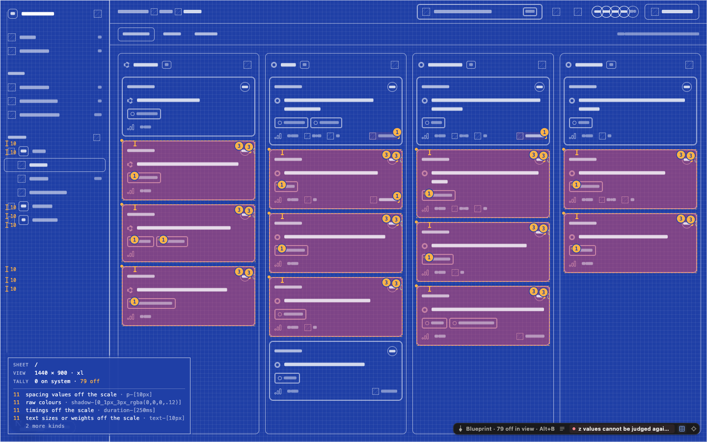

# Relay findings 4 result

Implemented the four fixes in order. No push. Existing `site/src/hero/Hero.jsx` and other unrelated work preserved. The only edited file under `examples/` is `examples/relay/next/plumber.config.ts`.

## Attribution and unchecked readings

- Authored source outside the app root or configured `source` is an attribution boundary. The locator returns the real relative file and an unchecked refusal; it cannot borrow an ancestor’s JSX, including a stamped ancestor.
- Alt’s tag/card says `not checked: ../src/screens/Board.jsx` and `Written in ../src/screens/Board.jsx, outside this project's source. Add it to source to check it.` CLI `explain`, including JSON output, reports the same status and file.
- Blueprint scans unstamped shared children even when neighboring app elements have source stamps. A mixed-source Vite fixture reproduced the old one-element, falsely clean reading; the same fixture now includes the unchecked children.
- Blueprint’s reader reports `checked`, `notChecked`, and `outsideSource` separately from completed `read` operations. The dock and title block show unchecked counts and `outside source`; neither claims `all true` while any reading is unchecked. Unplaced elements also count as unchecked.
- Client changes were necessary. Changes under `overlay/src` are limited to `locate.js`, `widget.js`, `blueprint-reader.js`, and `blueprint.js`: preserve the unchecked boundary, carry/count unchecked results, and display those counts. No visual redesign or CSS changes.

## Shared source and containment

- `source` accepts sibling globs such as `../src/**`, bounded by the nearest workspace manifest or Git checkout. With neither present, the app root remains the boundary. Selectors beyond that boundary are refused.
- Source membership, real paths, and the same boundary govern reads, source stamps, edits, and Apply. Windows separators are normalized before containment; foreign drive/UNC paths cannot bypass it. Symlinks do not grant source membership, and shared source is revalidated before reads after a symlink swap. Existing write hash, inode, hard-link, and atomic-save safeguards remain active.
- CSS token selectors now use actual relative paths rather than slicing an absolute filename at the app-root length, so shared CSS can supply decisions too.

## Readiness

- Authenticated source-resolution observations retain bounded file evidence in the Session. When observed rendered source is outside `source`, readiness marks `locate.source` missing and supplies an example file.
- A statically editable project config receives a consent diff adding the shared glob, for example `source: ["app/**", "../src/**"]`. The patch is regenerated on Apply; missing consent, stale hashes, dirty-file consent, config symlinks, exclusions, and repository/workspace escapes retain their safeguards. Opaque or unsafe configurations receive a manual step instead of an ineffective diff.
- After approval, refreshed readiness clears the gap and the same element resolves to its own shared source.
- Relay Next now sets `source: ['app/**', '../src/**']`.

## Relay board proof and timing

Matched routes: `http://127.0.0.1:4320/#/board` (Vite) and `http://127.0.0.1:4321/#/board` (Next 16.0.1 Turbopack). Chrome headless, 1440 × 900, reduced motion; fresh browser contexts, hosts and analysis ready before timing. Timing starts at Alt+B and ends when reader progress reaches `read === total`.

| Host | Blueprint read time | Reader progress | Source stamps |
| --- | ---: | --- | ---: |
| Vite | **0.67 s** | 260/260; 79 drift | 575 |
| Next | **17.77 s** | 260/260; 79 drift | 0 |

These are observed first-Blueprint-pass times after the full suite finished, with warm development hosts and fresh browser contexts, not startup or production timings. Source-location resolution dominates Next: **423 chunk/script reads, 243 map reads, and 948 Plumber batches**, versus Vite’s 167, 38, and 37. Next repeatedly requests the same compiled chunks and maps; its slowest chunk/script request took 9.61 s. Total instrumented marks drawing was only 0.19 s. Requests overlap, so their durations are not summed as wall time. **No performance optimisation was made.**

Both readers report **260/260 read, 79 drift, zero unchecked** at this viewport. All 79 rendered drift-label entries match across hosts, including multiplicity. Next has **zero source stamps**; Vite has 575 stamped DOM elements. The dock says `79 off in view` on both. The brief’s quoted 71 was not used as an expected value; this proof compares both actual readers at the same specified viewport.

[Next blueprint](relay-findings-4.next.png) · [Vite blueprint](relay-findings-4.vite.png) · [Measurement evidence](relay-findings-4.measurements.json)



## Verification

- Independent `fixtures/shared-source/next` and `fixtures/shared-source/vite` apps render `fixtures/shared-source/src/screens/Board.jsx`, outside each app root. They copy Relay’s shared-screen shape and import nothing from `examples/`.
- Real browser tests cover unchecked attribution, Alt card, CLI explain, Blueprint counts, source selection, Vite source stamps, unstamped Next owner stacks, edits/Apply, Windows paths, readiness evidence, consent rejection, successful config patch, and refreshed resolution.
- Integration tests cover out-of-workspace glob rejection, symlink exclusion and swaps, and existing linked-package/native-path behavior. Existing edit and text-write suites passed after the containment change.
- Focused readiness/shared-source run: **56 passed, zero failures**. Additional focused Vite shared-stamp and symlink-swap checks passed.

Full suite invoked once:

```sh
PLUMBER_CHROMIUM="/Applications/Google Chrome.app/Contents/MacOS/Google Chrome" npm test
```

Full run exited **0**:

| Invocation | Passed | Mode-specific skips | Failures |
| --- | ---: | ---: | ---: |
| Main suite | 523 | 1 | 0 |
| Session burst | 4 | 0 | 0 |
| Polling | 25 | 1 | 0 |
| Watch disabled | 23 | 3 | 0 |
| **Total** | **575** | **5** | **0** |

The mixed-source pool correction was found while the full run was active. The final reader was additionally verified by the shared-source suite (**5 passed**), Blueprint interaction suite (**12 passed**), and related Blueprint corner checks (**8 passed**). The full run's later shared-source, overlay, and mode checks also exercised the final client. No second full run was invoked. Windows path spellings were exercised on macOS; no native Windows run was performed.

Implementation commits:

- `8fea868` — preserve unchecked source attribution.
- `f76dedf` — count unchecked Blueprint readings.
- `7bcbf31` — allow bounded shared source.
- `f9f270a` — readiness source consent diff and shared-read revalidation.
- `292408c` — include unstamped shared children beside stamped source, retaining pick counts.

Every commit ends with the requested Claude co-author trailer. Demo config and this result/evidence are committed separately after verification.
